  
  
  

 

<table>
<tr>
<td width="55%" valign="top">

### ⚡ What I do

I build **production Flutter apps** for iOS & Android, and design the **backends** behind them with **Node.js** and **NestJS**.

- 📱 Apps live on the **App Store** & **Google Play**
- 📺 Took Flutter to **Smart TV** — video playback on LG webOS
- 🔐 APIs with JWT, role-based access & Stripe webhooks
- 🧱 Clean Architecture on mobile, layered services on the backend

</td>
<td width="45%" valign="top">

### 🌱 Right now

- 🔨 Going deep into **NestJS**: DI, guards, interceptors, TypeORM
- 📖 Posting a chapter-by-chapter series on **Grokking Algorithms**
- 🧠 Studying backend fundamentals: protocols, databases, system design

</td>
</tr>
</table>

 

<h3 align="center">🛠️ Stack</h3>

    
    
  

 

<h3 align="center">🚀 Featured Work</h3>

<table align="center">
<tr>
<td></td>
<td></td>
</tr>
<tr>
<td></td>
<td></td>
</tr>
</table>

  Shipped apps link to the App Store · also on <a href="https://play.google.com/store/apps/details?id=com.mdlabs.hr.sys">Google Play (MD-HR)</a> and <a href="https://play.google.com/store/apps/details?id=org.maknon.monitor">Google Play (Rased)</a>

 

  

  

